<picture>
  <source media="(prefers-color-scheme: dark)" srcset="assets/banner-dark.svg">
  
</picture>

<picture>
  <source media="(prefers-color-scheme: dark)" srcset="assets/title-intro-dark.svg">
  
</picture>
<picture>
  <source media="(prefers-color-scheme: dark)" srcset="assets/intro-dark.svg">
  
</picture>

<picture>
  <source media="(prefers-color-scheme: dark)" srcset="assets/title-works-dark.svg">
  
</picture>
<!-- works:start -->
<a href="https://github.com/Master-Norna/yan"><picture><source media="(prefers-color-scheme: dark)" srcset="assets/card-yan-dark.svg"></picture></a>
<a href="https://github.com/Master-Norna/tianlai"><picture><source media="(prefers-color-scheme: dark)" srcset="assets/card-tianlai-dark.svg"></picture></a>
<a href="https://github.com/Master-Norna/notes"><picture><source media="(prefers-color-scheme: dark)" srcset="assets/card-notes-dark.svg"></picture></a>
<a href="https://github.com/Master-Norna/formal-proof-of-fermats-last-theorem"><picture><source media="(prefers-color-scheme: dark)" srcset="assets/card-fermat-dark.svg"></picture></a>
<!-- works:end -->

<picture>
  <source media="(prefers-color-scheme: dark)" srcset="assets/title-oss-dark.svg">
  
</picture>
<picture>
  <source media="(prefers-color-scheme: dark)" srcset="assets/opensource-dark.svg">
  
</picture>
<picture>
  <source media="(prefers-color-scheme: dark)" srcset="assets/merged-dark.svg">
  
</picture>

<picture>
  <source media="(prefers-color-scheme: dark)" srcset="assets/title-ink-dark.svg">
  
</picture>
<picture>
  <source media="(prefers-color-scheme: dark)" srcset="assets/ink-dark.svg">
  
</picture>
